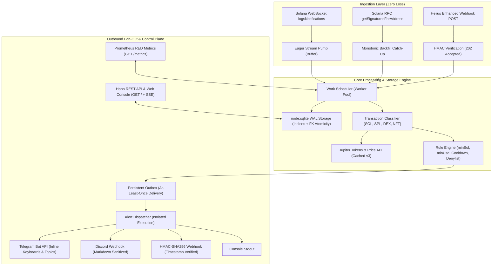

# solwatch

[](https://github.com/oscarbol09/solwatch/actions/workflows/ci.yml)


Self-hosted, high-reliability Solana wallet monitor and multi-channel alert router built with TypeScript, `@solana/kit`, Node 24 `node:sqlite`, `grammY`, and `hono`.

Delivers real-time whale and smart-money tracking, zero-drop WebSocket catch-up, dynamic SPL ATA discovery, SQLite-cached Jupiter USD valuations, and multi-channel routing (Telegram, Discord, HMAC-signed webhooks, stdout) with **\$0/mes in infrastructure costs**.

---

## Visual Previews

### Embedded Web Console (`GET /` with Live SSE Stream)

```text
┌────────────────────────────────────────────────────────────────────────────────────────┐
│  SOLWATCH CONSOLE  [● LIVE]  Cluster: mainnet-beta  Watched: 12  WS Reconnects: 0      │
├────────────────────────────────────────────────────────────────────────────────────────┤
│  HEALTH STRIP:  DB: healthy (WAL v3)  |  RPC: responsive (42ms)  |  Queue Depth: 0     │
├────────────────────────────────────────────────────────────────────────────────────────┤
│  LIVE STREAM (SSE)                                                                     │
│  [22:15:02] SWAP (Jupiter v6)  | Treasury Vault (9xQe...sVFin)                         │
│             1.5000 SOL ($324.50) -> 450,000 BONK                                       │
│             tx: 5j7s6NiJS3...5Dia7  |  [Solscan] [DexScreener]                         │
│                                                                                        │
│  [22:14:18] RECEIVED (USDC)    | Market Maker (Gsbw...QRJe)                            │
│             +1,250.00 USDC     | tx: 4uQeVj5t...9d1E  |  [Solscan]                     │
│                                                                                        │
│  [22:13:40] SPAM FILTERED      | Token-2022 Dust Mint (Spam...1111)                    │
│             Action: Blocked by Denylist  |  [+ Add Mint to Global Denylist]            │
├────────────────────────────────────────────────────────────────────────────────────────┤
│  CONTROL PLANE:  [+ Watch Wallet]   [Configure Rules]   [Backup DB]   [Send Test Alert]│
└────────────────────────────────────────────────────────────────────────────────────────┘
```

### Telegram Interactive Alert & Rich Card

```text
🔔 Main Treasury (+2.5 SOL received)
Amount: 2.5 SOL ($541.25 USD)
From: Gsbw...QRJe
Slot: 312,500,110
Tx: 5VERv8NM...kQUW

[ 🔍 View on Solscan ]   [ 💼 Wallet Overview ]
[ 📈 DexScreener ]       [ ⏸️ Pause Alerts ]
```

---

## Why This Exists

Most ad-hoc Solana wallet trackers break in the same three ways when deployed for real operational monitoring:

1. **The Reconnect Blindspot:** Public WebSocket connections drop and reconnect under network jitter. Naive trackers miss every transaction that lands during the disconnect window, while lazy consumers (`for await` on `@solana/subscribable`) drop live messages emitted during backfill.
2. **The Spam and 0-SOL Flood:** Unfiltered `logsSubscribe` streams flood Telegram or Discord chats with failed transactions, 0-SOL compute budget invocations, and dusting airdrop tokens.
3. **Infrastructure Bloat:** Heavy commercial stacks demand Redis clusters, Kafka, and PostgreSQL just to track a handful of treasury or smart-money wallets.

`solwatch` solves these fundamentally:

- **Zero-Loss Reconnect Pipeline:** Eager stream pumping buffers live WebSocket frames while `getSignaturesForAddress` catches up across pagination boundaries with monotonic slot cursors.
- **Dynamic ATA Discovery:** Tracks Associated Token Accounts (SPL Token & Token-2022) via `getTokenAccountsByOwner` so secondary token transfers are never missed.
- **Zero-Cost USD Valuations:** Queries Jupiter Tokens API v2 and Price API v3 with in-memory TTL and local SQLite caching to evaluate `minUsd` thresholds without paid CoinGecko/CoinMarketCap API keys.
- **Embedded Simplicity:** Uses Node 24's native `node:sqlite` in WAL mode (`DatabaseSync`) with `busy_timeout = 5000` and automated online backups (`VACUUM INTO ?`), running the entire engine, API, web console, and bot in a single self-contained container consuming `< 100 MB` RAM.

---

## Competitive Benchmark

| Feature / Capability          |        `solwatch` (Self-Hosted)         |   RayBot (Telegram)    |     Cielo Finance      |    Custom Geyser Bot     |
| :---------------------------- | :-------------------------------------: | :--------------------: | :--------------------: | :----------------------: |
| **SPL Ingestion on ATAs**     | **Complete** (ATA discovery + Webhook)  |        Complete        |        Complete        |         Complete         |
| **Asset Pricing & USD Value** | **Jupiter API ($0/mes)** + SQLite cache |      Native (USD)      |      Native (USD)      |    Variable / Custom     |
| **Live Control Plane**        |  **Web SPA + REST API + Telegram Bot**  |     Telegram only      |     SaaS Dashboard     |     None / CLI only      |
| **Embedded Web Console**      |      **Built-in (`GET /` + SSE)**       |          None          |    SaaS Cloud only     |           None           |
| **Data Privacy & Custody**    | **100% Self-Hosted (Zero 3rd parties)** |     Custodial SaaS     |      Closed SaaS       |       Self-Hosted        |
| **Infrastructure Cost**       |    **$0/mes** (Free tier compatible)    | Freemium ($20–$100/mo) | Freemium ($30–$200/mo) | $49–$250/mo (RPC/Geyser) |
| **Extensibility & Contracts** |  **OpenAPI 3.1 + HMAC Webhooks v1.1**   |      Proprietary       | Proprietary / Webhooks |       Custom code        |

---

## Quickstart (Zero-Config Demo)

Requires Node.js `>=24.0.0`. No API keys or external databases needed to explore the complete pipeline:

```bash
git clone https://github.com/oscarbol09/solwatch.git
cd solwatch
npm install
npm run demo
```

`npm run demo` initializes an in-memory SQLite store and replays realistic Solana transactions through the classifier, deduplication store, rule engine, and console formatter (including duplicate signatures and denylisted Token-2022 spam mints).

### Launching with Embedded Web UI

```bash
npm run demo -- --ui
```
Opens the embedded web console (`GET /`) and OpenAPI interactive explorer (`GET /docs`) on `http://127.0.0.1:3000`.

### Streaming Live Wallets from Mainnet or Devnet

```bash
npm run demo -- --live <SOLANA_WALLET_ADDRESS> --cluster mainnet-beta --min-sol 0.1
```

---

## Production Setup & Docker

### 1. Configure Environment

Copy the configuration template:

```bash
cp .env.example .env
```

Configure your RPC URL, alert channels, and security secrets. Generate high-entropy secrets (`>= 32` characters) for API tokens:

```bash
# Generate 32-character hex secret
node -e "console.log(require('crypto').randomBytes(16).toString('hex'))"
```

### 2. Launch Container

```bash
docker compose up -d --build
```

The container runs under an isolated rootless user (`UID 10001:10001`), drops all Linux capabilities (`cap_drop: [ALL]`), mounts a read-only root filesystem, and persists database state inside a dedicated `./data` volume with `0o700` permissions.

### 3. Verify Health & Register a Wallet

```bash
# Check service liveness
curl http://127.0.0.1:3000/healthz

# Check service readiness (database WAL ping + watcher connectivity)
curl http://127.0.0.1:3000/readyz

# Register a wallet to track
curl -X POST http://127.0.0.1:3000/api/wallets \
  -H "Content-Type: application/json" \
  -H "Authorization: Bearer $API_TOKEN" \
  -d '{"address":"9xQeWvG816bUx9EPjHmaT23yvVM2ZWbrrpZb9PusVFin","label":"Treasury Vault"}'
```

---

## System Architecture



---

## Telegram Bot Commands

When `TELEGRAM_INTERACTIVE_ENABLED=true` is set, `solwatch` registers commands via `setMyCommands` and enforces chat/user ACLs:

| Command                    | Description                                                                |
| :------------------------- | :------------------------------------------------------------------------- |
| `/watch <address> [label]` | Start live tracking for a Solana wallet                                    |
| `/unwatch <target>`        | Stop tracking a wallet by address, numeric index, or label                 |
| `/pause <target>`          | Temporarily pause outbound alerts for a wallet                             |
| `/resume <target>`         | Resume outbound alerts for a paused wallet                                 |
| `/list`                    | Show tracked wallets with interactive Pause / Resume / Solscan buttons     |
| `/rules`                   | Display active global and per-wallet alert rules                           |
| `/setmin <sol>`            | Update the global minimum SOL alert threshold                              |
| `/denylist <mint>`         | Add a token mint to the global spam denylist                               |
| `/recent`                  | View the 5 most recent alert deliveries grouped by signature               |
| `/test`                    | Trigger a synthetic test alert across all active channels                  |
| `/status`                  | Report cluster, active channels, reconnect counts, and pipeline statistics |

> **Security Note:** In group chats (`chat_id < 0`), mutations (`/watch`, `/unwatch`, `/pause`, `/resume`, `/setmin`, `/denylist`, `/test`) are strictly restricted to user IDs listed in `TELEGRAM_ALLOWED_USER_IDS`.

---

## HTTP REST API & Embedded Console

All mutation endpoints require `Authorization: Bearer <API_TOKEN>` (`>= 32` characters).

| Method & Path                  | Auth            | Purpose                                                                          |
| :----------------------------- | :-------------- | :------------------------------------------------------------------------------- |
| `GET /`                        | Public / Token  | Embedded dark-mode web console (Live SSE feed, wallet manager, 1-click denylist) |
| `GET /openapi.json`            | Public          | OpenAPI 3.1.0 schema definition                                                  |
| `GET /docs`                    | Public          | Interactive OpenAPI documentation explorer                                       |
| `GET /healthz`                 | Public          | Minimal container liveness probe (`{"status":"ok"}`)                             |
| `GET /readyz`                  | Public          | Deep readiness probe verifying SQLite WAL ping and watcher connectivity          |
| `GET /metrics`                 | Public / Bearer | Native Prometheus RED metrics exporter (`text/plain; version=0.0.4`)             |
| `GET /api/status`              | Bearer          | Extended system metrics, active channels, and queue statistics                   |
| `GET /api/wallets`             | Bearer          | List all tracked wallets with scoped rules and cursors                           |
| `POST /api/wallets`            | Bearer          | Register a new wallet for live tracking                                          |
| `GET /api/wallets/:address`    | Bearer          | Retrieve details and rules for a specific wallet                                 |
| `PATCH /api/wallets/:address`  | Bearer          | Update wallet label or toggle `enabled` state                                    |
| `DELETE /api/wallets/:address` | Bearer          | Remove wallet and terminate associated watcher tasks                             |
| `GET /api/rules`               | Bearer          | List all active alert rules (global and per-wallet)                              |
| `POST /api/rules`              | Bearer          | Create a new alert rule (`minSol`, `minUsd`, `cooldownSeconds`)                  |
| `PUT /api/rules/:id`           | Bearer          | Replace an existing alert rule                                                   |
| `PATCH /api/rules/:id`         | Bearer          | Partially update rule parameters                                                 |
| `DELETE /api/rules/:id`        | Bearer          | Delete a rule                                                                    |
| `POST /api/rules/denylist`     | Bearer          | Add a token mint to the global spam denylist                                     |
| `GET /api/alerts`              | Bearer          | Query delivery audit history with keyset pagination (`?limit=25&beforeId=...`)   |
| `POST /api/alerts/test`        | Bearer          | Dispatch synthetic test alert across all active channels                         |
| `GET /api/events/stream`       | Bearer          | Live Server-Sent Events (SSE) event stream                                       |
| `POST /webhooks/helius`        | Secret          | Ingest Helius Enhanced Webhook payloads (fail-closed if secret unset)            |

---

## Outbound Webhook Verification (HMAC-SHA256)

When `WEBHOOK_SECRET` is configured, all outbound HTTP webhook deliveries include cryptographic authentication headers:

- `X-Solwatch-Delivery`: Unique UUID for the delivery attempt.
- `X-Solwatch-Event`: Event classification (`sol_transfer`, `spl_transfer`, `dex_swap`, `program_interaction`).
- `X-Solwatch-Timestamp`: Unix epoch timestamp in seconds.
- `X-Solwatch-Signature`: `sha256=<hex_digest>` computed over `${timestamp}.${deliveryId}.${eventKind}.${rawBody}`.

### Verification Implementation Example

```ts
import { createHmac, timingSafeEqual } from "node:crypto";

export function verifySolwatchWebhook(params: {
  rawBody: string;
  signatureHeader: string;
  timestampHeader: string;
  deliveryIdHeader: string;
  eventKindHeader: string;
  webhookSecret: string;
  toleranceSeconds?: number;
}): boolean {
  if (!/^\d{1,12}$/.test(params.timestampHeader)) return false;

  const timestamp = Number(params.timestampHeader);
  const ageSeconds = Math.abs(Math.floor(Date.now() / 1_000) - timestamp);
  if (ageSeconds > (params.toleranceSeconds ?? 300)) {
    return false; // Anti-replay window violation (default ±5 minutes)
  }

  const payload = `${params.timestampHeader}.${params.deliveryIdHeader}.${params.eventKindHeader}.${params.rawBody}`;
  const expectedDigest = createHmac("sha256", params.webhookSecret).update(payload).digest("hex");
  const expectedHeader = `sha256=${expectedDigest}`;

  const receivedBuffer = Buffer.from(params.signatureHeader, "utf8");
  const expectedBuffer = Buffer.from(expectedHeader, "utf8");

  return (
    receivedBuffer.length === expectedBuffer.length &&
    timingSafeEqual(receivedBuffer, expectedBuffer)
  );
}
```

---

## Environment Variables Reference

| Variable                           | Type / Constraints                                | Default              | Description                                                       |
| :--------------------------------- | :------------------------------------------------ | :------------------- | :---------------------------------------------------------------- |
| **`SOLANA_CLUSTER`**               | `mainnet-beta` \| `devnet` \| `testnet`           | `mainnet-beta`       | Target Solana network cluster                                     |
| **`SOLANA_RPC_URL`**               | Valid HTTP/S URL                                  | Public RPC           | HTTP RPC endpoint for transaction fetching                        |
| **`SOLANA_WS_URL`**                | Valid WS/WSS URL                                  | Public WS            | WebSocket endpoint for log notifications                          |
| **`SOLANA_COMMITMENT`**            | `processed` \| `confirmed` \| `finalized`         | `confirmed`          | Solana commitment level for subscriptions                         |
| **`DATABASE_PATH`**                | File path                                         | `./data/solwatch.db` | SQLite database file location                                     |
| **`PORT`**                         | Integer (1–65535)                                 | `3000`               | HTTP API server port                                              |
| **`HOST`**                         | IP address / hostname                             | `127.0.0.1`          | Network interface to bind (`0.0.0.0` in Docker)                   |
| **`API_TOKEN`**                    | String (`>= 32` characters)                       | _None_               | Bearer token for REST API and embedded console                    |
| **`HELIUS_WEBHOOK_SECRET`**        | String (`>= 32` characters)                       | _None_               | Shared secret for Helius webhook ingestion                        |
| **`ALLOW_UNAUTHENTICATED_API`**    | Boolean                                           | `false`              | Disables auth for local debugging (prohibited in prod)            |
| **`ALLOW_PRIVATE_WEBHOOK_URLS`**   | Boolean                                           | `false`              | Permits webhooks to loopback/RFC1918 IPs (dev only)               |
| **`TRUST_PROXY`**                  | Boolean                                           | `false`              | Honors `X-Forwarded-For` for rate limiting behind reverse proxies |
| **`MAX_WATCHED_WALLETS`**          | Integer (1–10,000)                                | `100`                | Global capacity limit on watched wallets                          |
| **`API_RATE_LIMIT_MAX`**           | Integer (1–10,000)                                | `120`                | Maximum HTTP requests allowed per client window                   |
| **`API_RATE_LIMIT_WINDOW_MS`**     | Integer (1,000–3,600,000)                         | `60000`              | Rate limit sliding window duration in milliseconds                |
| **`CONSOLE_ALERTS_ENABLED`**       | Boolean                                           | `true`               | Emits formatted alert summaries to stdout                         |
| **`TELEGRAM_BOT_TOKEN`**           | String (`<id>:<token>`)                           | _None_               | Bot token obtained from Telegram `@BotFather`                     |
| **`TELEGRAM_ALERT_CHAT_ID`**       | Numeric string / ID                               | _None_               | Target chat ID for outbound Telegram alerts                       |
| **`TELEGRAM_ALERT_THREAD_ID`**     | Numeric string                                    | _None_               | Forum topic thread ID for supergroups                             |
| **`TELEGRAM_ALLOWED_CHAT_IDS`**    | Comma-separated IDs                               | _None_               | Chats authorized to interact with the bot                         |
| **`TELEGRAM_ALLOWED_USER_IDS`**    | Comma-separated IDs                               | _None_               | Admin user IDs authorized to execute wallet mutations             |
| **`TELEGRAM_INTERACTIVE_ENABLED`** | Boolean                                           | `false`              | Enables interactive slash commands and inline keyboards           |
| **`DISCORD_WEBHOOK_URL`**          | Discord Webhook URL                               | _None_               | Webhook URL for rich Discord embed delivery                       |
| **`WEBHOOK_URL`**                  | Valid HTTPS URL                                   | _None_               | Destination endpoint for generic JSON alert webhooks              |
| **`WEBHOOK_SECRET`**               | String (`>= 32` characters)                       | _None_               | Secret key for outbound HMAC-SHA256 signing                       |
| **`MIN_SOL_ALERT`**                | Decimal string                                    | `0.1`                | Global minimum SOL transfer threshold                             |
| **`MIN_USD_ALERT`**                | Decimal string                                    | _None_               | Global minimum USD valuation threshold                            |
| **`PRICE_ENRICHMENT_ENABLED`**     | Boolean                                           | `true`               | Enables Jupiter API token metadata & USD pricing                  |
| **`DEFAULT_COOLDOWN_SECONDS`**     | Integer (0–86,400)                                | `0`                  | Default alert cooldown per wallet + event type                    |
| **`INCLUDE_FAILED_TX`**            | Boolean                                           | `false`              | Whether to dispatch alerts for failed transactions                |
| **`DASHBOARD_ENABLED`**            | Boolean                                           | `true`               | Serves embedded dark-mode console on `GET /`                      |
| **`CORS_ORIGIN`**                  | String / URL                                      | _None_               | `Access-Control-Allow-Origin` header value                        |
| **`LOG_LEVEL`**                    | `fatal` \| `error` \| `warn` \| `info` \| `debug` | `info`               | Logging verbosity (Pino)                                          |

---

## Operational Runbooks

### 1. Online SQLite WAL Backup Runbook

`solwatch` provides an atomic, lock-free online backup script utilizing SQLite's native `VACUUM INTO ?` command. It snapshots the database in real-time without locking active transactions:

```bash
# Execute online backup to a timestamped file
npm run backup -- ./backups/solwatch_$(date +%Y%m%d_%H%M%S).db

# Or invoke directly via Node
node dist/scripts/backup.js ./backups/solwatch_backup.db
```

#### Automated Daily Backup via Cron (Linux)

```cron
0 3 * * * cd /opt/solwatch && /usr/bin/node dist/scripts/backup.js /var/backups/solwatch/solwatch_$(date +\%F).db >> /var/log/solwatch-backup.log 2>&1
```

### 2. Prometheus Observability & Alerting

`solwatch` exposes metrics following the RED method (Rate, Errors, Duration) on `GET /metrics`:

- `http_requests_total{method, route, status}`: Request counter partitioned by route.
- `http_request_duration_seconds{method, route, le}`: Latency histogram (11 buckets).
- `solwatch_processed_total`: Cumulative transaction count processed.
- `solwatch_dispatched_total{channel}`: Outbound alert count partitioned by channel.
- `solwatch_deduped_total`: Duplicate transactions safely suppressed.
- `solwatch_filtered_total{reason}`: Filtered events partitioned by reject reason (`below_min_sol`, `below_min_usd`, `mint_denylisted`, `cooldown_active`).
- `solwatch_queue_depth`: Instantaneous worker queue depth.
- `solwatch_outbox_pending_count`: Pending outbox deliveries awaiting dispatch.
- `solwatch_ws_reconnects_total`: Cumulative WebSocket reconnection counter.

---

## Development & Test Verification

```bash
# Run Biome formatting & linter check
npm run lint

# Run strict TypeScript typechecking
npm run typecheck

# Run full Vitest suite with v8 coverage (118 tests across 20 suites)
npm run test:coverage

# Build production bundle to dist/
npm run build

# Execute offline replay smoke test
node dist/demo.js
```

---

## Commercial Licensing, Support & Custom Integrations

`solwatch` is developed and maintained as high-craft, production-ready software by **Oscar Bolaños**.

For:

- **Commercial Deployment Licenses** (enterprise production use without source-available restrictions)
- **Bespoke Protocol Integrations** (custom DEX routers, proprietary liquidity pools, Geyser gRPC ingest pipelines)
- **Whitelabel Deployments** (branded Telegram bots, custom trader dashboards, enterprise webhooks)
- **Security & Architectural Consulting**

Please contact directly:

- **Email:** [oscarbol09@gmail.com](mailto:oscarbol09@gmail.com)
- **GitHub Repository:** [https://github.com/oscarbol09/solwatch](https://github.com/oscarbol09/solwatch)
- **Issue Tracker:** [https://github.com/oscarbol09/solwatch/issues](https://github.com/oscarbol09/solwatch/issues)

---

## License

Source-available (`All Rights Reserved`). Publicly readable for technical evaluation; copying, redistribution, and commercial deployment require written permission from the author. See [LICENSE](./LICENSE).
