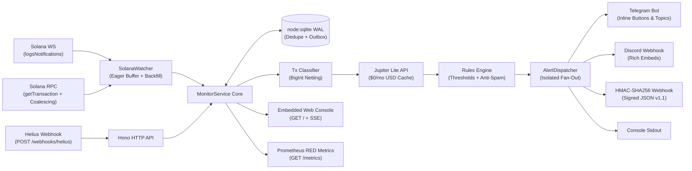

# solwatch

[](https://github.com/oscarbol09/solwatch/actions/workflows/ci.yml)
[](https://github.com/oscarbol09/solwatch/actions)
[](https://nodejs.org/)
[](https://github.com/solana-labs/solana-web3.js)
[](https://nodejs.org/api/sqlite.html)
[](./LICENSE)

**Self-hosted, read-only Solana wallet monitor and multi-channel alert router** built with modern TypeScript, `@solana/kit`, Node 24 native `node:sqlite`, `grammy`, and `hono`.

Operates at **$0/mo infrastructure cost** with zero external cloud databases (no Redis, no PostgreSQL, no C++ compilation dependencies).

---

## Visual Preview

```text
┌────────────────────────────────────────────────────────────────────────────────────────────────┐
│  SOLWATCH CONSOLE — Live Solana Treasury & Smart-Money Radar                                   │
├────────────────────────────────────────────────────────────────────────────────────────────────┤
│  [OK] [Main Treasury] +2.5 SOL (received)                                                      │
│    tx: 5VERv8NMvzbJMEkV8xnrLkEaWRtSz9CosKDYjCJjBRnbJLgp8uirBgmQpjKhoR4tjF3ZpRzrFmBV6UjKdiSZkQ...│
│    url: https://solscan.io/tx/5VERv8NM... | slot: 312500110                                    │
│                                                                                                │
│  [OK] [Main Treasury] Swap on Jupiter: 1.5 SOL -> 240 USDC ($240.00)                           │
│    tx: 5j7s6NiJS3JAkvgkoc18WVAsiSaci2pxB2A6ueCJP4tprA2TFg9wSyTLeYouxPBJEMzJinENTkpA52YStRW5Dia7...│
│    url: https://solscan.io/tx/5j7s6NiJ... | slot: 312500330                                    │
│                                                                                                │
│  [DEDUPED] Duplicate signature 4uQeVj5t... ignored by SQLite WAL deduplication store           │
│  [FILTERED:mint_denylisted] Suppressed Token-2022 dust airdrop (4k3Dyjzvzp8eMZWUXbBCjEvw...)   │
│  [FILTERED:failed_tx_suppressed] Suppressed failed Jupiter swap transaction                    │
└────────────────────────────────────────────────────────────────────────────────────────────────┘
```

_Live embedded web console (`GET /`) with Server-Sent Events (SSE) and dark-mode management interface:_

```text
┌────────────────────────────────────────────────────────────────────────────────────────────────┐
│ solwatch web console | Cluster: mainnet-beta | WS: Connected | Active: 3 wallets               │
├───────────────────────────────┬────────────────────────────────────────────────────────────────┤
│ Tracked Wallets               │ Real-Time Activity Stream (SSE)                                │
│ • Treasury (9xQe...sVFin) [✓] │ [22:30:15] SWAP: Jupiter 1.5 SOL -> 240 USDC ($240.00)         │
│ • Alpha Whale (Gsbw...QRJe)[✓]│ [22:30:42] SOL IN: +15.0 SOL from 3AVi...kzPT                 │
│ • Vault (4k3D...X6R)     [II] │ [22:31:05] FILTERED: Token-2022 spam mint blocked by denylist │
└───────────────────────────────┴────────────────────────────────────────────────────────────────┘
```

---

## Why Solwatch?

Most ad-hoc Solana monitoring scripts and commercial bot platforms fail in production:

| Challenge               | Naive Bot Scripts                                    | Heavy SaaS Platforms                     | **solwatch**                                               |
| :---------------------- | :--------------------------------------------------- | :--------------------------------------- | :--------------------------------------------------------- |
| **Reconnect Drops**     | Misses all txs landing during WebSocket reconnection | Requires $150–$300/mo Geyser node        | **Eager buffering + chronological RPC backfill catch-up**  |
| **Spam / 0-SOL Floods** | Floods Telegram chats with zero-fee calls and dust   | Filters behind paid premium tiers        | **Exact `BigInt` balance netting + mint allow/denylists**  |
| **Infrastructure Cost** | Unstable local scripts                               | $100–$500/mo (Redis + Postgres + VPC)    | **$0/mo (Node 24 native SQLite WAL, runs on $4 VPS)**      |
| **USD Valuation**       | Hardcoded or stale prices                            | Paid CoinGecko / Birdeye API tiers       | **Zero-cost Jupiter Lite API (`$0/mo`) with SQLite cache** |
| **Security & Privacy**  | Stores keys or exposes unauthenticated endpoints     | Third-party custody of wallet watchlists | **100% read-only (zero private keys), SSRF-hardened**      |

---

## Architecture



---

## Quickstart (Zero-Config)

Requires Node.js `>=24.0.0`. No API keys or external services required:

```bash
# 1. Clone repository
git clone https://github.com/oscarbol09/solwatch.git
cd solwatch

# 2. Install dependencies
npm install

# 3. Run zero-config offline replay demo (6 realistic mainnet transactions)
npm run demo
```

### Interactive Web Console Demo

Launch the embedded real-time web dashboard and OpenAPI explorer on `http://127.0.0.1:3000`:

```bash
npm run demo -- --ui
```

### Live Wallet Tracking (CLI)

Stream live transactions for any address on Devnet or Mainnet without running the server:

```bash
npm run demo -- --live 9xQeWvG816bUx9EPjHmaT23yvVM2ZWbrrpZb9PusVFin --cluster mainnet-beta --min-sol 0.1
```

---

## Production Deployment (Docker Compose)

1. Copy and configure environment variables:

   ```bash
   cp .env.example .env
   ```

2. Start the container with Docker Compose (runs as isolated non-root user `10001:10001` with read-only root filesystem and `tmpfs`):

   ```bash
   docker compose up -d --build
   ```

3. Verify service health and register a wallet:

   ```bash
   # Verify health and readiness probes
   curl http://localhost:3000/healthz
   curl http://localhost:3000/readyz

   # Register a wallet to monitor
   curl -X POST http://localhost:3000/api/wallets \
     -H "Content-Type: application/json" \
     -H "Authorization: Bearer YOUR_API_TOKEN_HERE" \
     -d '{"address":"9xQeWvG816bUx9EPjHmaT23yvVM2ZWbrrpZb9PusVFin","label":"Main Treasury"}'
   ```

4. Trigger an online SQLite backup snapshot without locking active transactions:

   ```bash
   npm run backup -- ./data/backups/manual-backup.db
   ```

---

## Interactive Telegram Bot

Enable Telegram management by configuring `TELEGRAM_BOT_TOKEN`, `TELEGRAM_INTERACTIVE_ENABLED=true`, and restricting access with `TELEGRAM_ALLOWED_CHAT_IDS`:

| Command     | Arguments                     | Description                                                             |
| :---------- | :---------------------------- | :---------------------------------------------------------------------- |
| `/watch`    | `<address> [label]`           | Register and start monitoring a wallet immediately                      |
| `/unwatch`  | `<address \| index \| label>` | Stop tracking a wallet                                                  |
| `/pause`    | `<address \| index \| label>` | Temporarily pause alerts for a wallet                                   |
| `/resume`   | `<address \| index \| label>` | Resume paused wallet tracking                                           |
| `/list`     | —                             | Display all tracked wallets with interactive inline action buttons      |
| `/rules`    | —                             | View active alert filtering rules (`minSol`, `minUsd`, denylists)       |
| `/setmin`   | `<sol>`                       | Update global minimum SOL transfer threshold                            |
| `/denylist` | `<mint>`                      | Append an SPL token mint to the global denylist                         |
| `/recent`   | —                             | Show recent delivery outcomes across all channels                       |
| `/test`     | —                             | Dispatch a synthetic test alert to verify notification channels         |
| `/status`   | —                             | Display uptime, active channels, WebSocket state, and pipeline counters |

---

## HTTP REST API & Control Plane

When binding `HOST` beyond loopback (`0.0.0.0`), `API_TOKEN` (>= 32 characters) is mandatory.

| Endpoint                       |  Method  |      Auth      | Description                                                      |
| :----------------------------- | :------: | :------------: | :--------------------------------------------------------------- |
| `GET /`                        |  `GET`   | Browser Prompt | Embedded real-time web console with live SSE feed                |
| `GET /docs`                    |  `GET`   |     Public     | Interactive OpenAPI 3.1 documentation explorer                   |
| `GET /healthz`                 |  `GET`   |     Public     | Lightweight container liveness check (`{"status":"ok"}`)         |
| `GET /readyz`                  |  `GET`   |     Public     | Readiness check verifying SQLite WAL ping & watcher connectivity |
| `GET /metrics`                 |  `GET`   |     Public     | Prometheus RED metrics exporter (`text/plain; version=0.0.4`)    |
| `GET /api/status`              |  `GET`   |     Bearer     | System uptime, active channels, queue depths, and counters       |
| `GET /api/wallets`             |  `GET`   |     Bearer     | List all watched wallets, cursors, and labels                    |
| `POST /api/wallets`            |  `POST`  |     Bearer     | Add a new wallet to the monitoring watchlist                     |
| `PATCH /api/wallets/:address`  | `PATCH`  |     Bearer     | Update label or toggle pause/resume state                        |
| `DELETE /api/wallets/:address` | `DELETE` |     Bearer     | Remove a wallet and terminate its subscription loop              |
| `GET /api/rules`               |  `GET`   |     Bearer     | Inspect active alert filtering rules                             |
| `POST /api/rules`              |  `POST`  |     Bearer     | Create a new custom filtering rule                               |
| `POST /api/rules/denylist`     |  `POST`  |     Bearer     | Add a token mint to the global blacklist                         |
| `GET /api/alerts`              |  `GET`   |     Bearer     | Keyset-paginated (`beforeId`) audit delivery log                 |
| `POST /api/alerts/test`        |  `POST`  |     Bearer     | Trigger an end-to-end synthetic alert across active channels     |
| `GET /api/events/stream`       |  `GET`   |     Bearer     | Real-time Server-Sent Events (SSE) alert stream                  |
| `POST /webhooks/helius`        |  `POST`  |     Secret     | Ingest Helius Enhanced Webhook transaction arrays                |

Detailed request/response schemas are available in [docs/API.md](./docs/API.md) and `/docs`.

---

## Verifying Signed Webhooks (HMAC-SHA256)

Outbound webhook deliveries include `X-Solwatch-Timestamp`, `X-Solwatch-Delivery`, `X-Solwatch-Event`, and `X-Solwatch-Signature` headers.

```typescript
import { createHmac, timingSafeEqual } from "node:crypto";

export function verifyWebhookSignature(params: {
  rawBody: string;
  signature: string;
  timestamp: string;
  deliveryId: string;
  eventKind: string;
  secret: string;
}): boolean {
  // Reject payloads older than 5 minutes (replay defense)
  if (Math.abs(Math.floor(Date.now() / 1000) - Number(params.timestamp)) > 300) return false;

  const payload = `${params.timestamp}.${params.deliveryId}.${params.eventKind}.${params.rawBody}`;
  const expected = `sha256=${createHmac("sha256", params.secret).update(payload).digest("hex")}`;

  return timingSafeEqual(Buffer.from(params.signature), Buffer.from(expected));
}
```

---

## Known Trade-offs & Limitations

1. **Single-Node SQLite Architecture:** Built using Node 24's native `DatabaseSync` in WAL mode to eliminate external databases (PostgreSQL/Redis) and native C++ builds (`node-gyp`). Sized for up to **10,000 active wallets per instance**; horizontal multi-master scaling is intentionally out of scope.
2. **Public RPC vs Dedicated Endpoints:** Public Solana RPC nodes aggressively rate-limit `getTransaction` and close idle WebSockets. For high-volume trading accounts, point `SOLANA_RPC_URL` / `SOLANA_WS_URL` to a dedicated provider (Helius, QuickNode, Triton) or configure inbound `POST /webhooks/helius`.
3. **Swap Heuristics:** Swaps are classified using liquidity pool address matching and net wallet balance deltas for registered protocols (Jupiter, Raydium, Orca, Meteora, Pump.fun). Complex multi-hop CPI calls outside the registry are classified as generic program interactions.
4. **Strictly Read-Only Scope:** `solwatch` monitors and alerts only. It contains no private key management, swap execution, or automated trading modules.

---

## Comprehensive Documentation

- [Architecture Deep-Dive](./docs/ARCHITECTURE.md) — Detailed subsystem breakdowns, data flow, and invariants.
- [Operational Runbook](./docs/RUNBOOK.md) — Deployment, Prometheus monitoring, disaster recovery, and troubleshooting.
- [API & Webhook Specification](./docs/API.md) — Complete endpoint documentation and cryptographic payload reference.

---

## Commercial Licensing, Consulting & Author

`solwatch` is developed and maintained by **Oscar Bolaño** as a production-grade, source-available Web3 engineering showcase.

### Services Available:

- **Custom Blockchain Tracking & Telegram Bots:** Bespoke alert engines tailored to proprietary token strategies, MEV monitoring, or automated trading signals.
- **Web3 Backend Engineering & High-Performance Microservices:** Architecture design, TypeScript/Node.js/Go backend pipelines, and zero-cost infrastructure optimization.
- **Security & Smart Contract Auditing:** Threat modeling, SSRF defenses, and cryptographic verification pipelines.

### Contact:

- **GitHub:** [@oscarbol09](https://github.com/oscarbol09)
- **Email:** [oscarbol09@gmail.com](mailto:oscarbol09@gmail.com)
- **Repository:** [https://github.com/oscarbol09/solwatch](https://github.com/oscarbol09/solwatch)

---

## License

Source-available (`All Rights Reserved`). Publicly viewable for technical evaluation, code review, and personal verification. Unauthorized copying, modification, redistribution, or commercial SaaS operation is prohibited without written permission. See [LICENSE](./LICENSE).
