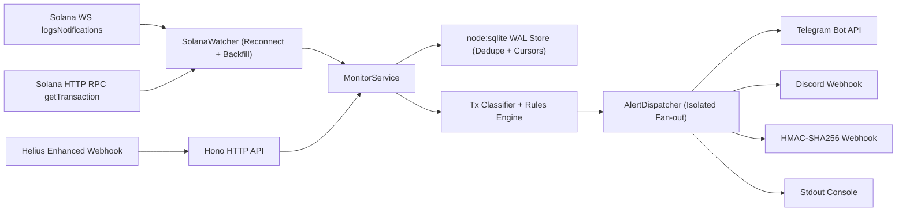

# solwatch

Self-hosted, read-only Solana wallet monitor and multi-channel alert router built with TypeScript, `@solana/kit`, Node 24 `node:sqlite`, `grammy`, and `hono`.

## Why This Exists

Most ad-hoc Solana wallet trackers break in the same three ways when deployed for real operational monitoring:

1. Public WebSocket subscriptions silently drop and miss every transaction that lands during the reconnect window.
2. Unfiltered `logsSubscribe` streams flood Telegram or Discord chats with 0-SOL fee calls, failed transactions, and airdrop spam mints.
3. Heavy stacks demand Redis + PostgreSQL just to watch a handful of treasury or smart-money wallets.

`solwatch` handles reconnect catch-up via `getSignaturesForAddress`, computes exact `BigInt` asset deltas to filter out fee-only calls and spam mints, deduplicates signatures in local SQLite WAL storage, and routes clean alerts to Telegram, Discord, HMAC-signed webhooks, or stdout. It never stores private keys or signs transactions.

## Quickstart (Zero-Config Demo)

Requires Node.js `>=24.0.0`. No API keys or external database needed to try the full pipeline:

```bash
git clone https://github.com/oscarbol09/solwatch.git
cd solwatch
npm install
npm run demo
```

`npm run demo` runs an in-memory SQLite store and replays six realistic Solana transactions through the classifier, deduplication store, rule engine, and console formatter (including a duplicate signature and a denylisted Token-2022 spam mint). Pass `--ui` (`npm run demo -- --ui`) to launch the embedded web console (`GET /`) and OpenAPI explorer (`GET /docs`) on `http://127.0.0.1:3000`.

To stream a live wallet from Devnet or Mainnet without running the HTTP server:

```bash
npm run demo -- --live <SOLANA_WALLET_ADDRESS> --cluster devnet --min-sol 0
```

## Production Setup & Docker

1. Copy the environment template and configure only the channels you want to enable:

```bash
cp .env.example .env
```

2. Start with Docker Compose:

```bash
docker compose up -d --build
```

3. Verify the container health and register a wallet:

```bash
curl http://localhost:3000/healthz
curl -X POST http://localhost:3000/api/wallets \
  -H "Content-Type: application/json" \
  -H "Authorization: Bearer $API_TOKEN" \
  -d '{"address":"9xQeWvG816bUx9EPjHmaT23yvVM2ZWbrrpZb9PusVFin","label":"Treasury"}'
```

## Architecture



## Telegram Bot Commands

Enable interactive commands by setting `TELEGRAM_BOT_TOKEN`, `TELEGRAM_INTERACTIVE_ENABLED=true`, restricting chats via `TELEGRAM_ALLOWED_CHAT_IDS`, and scoping `/watch` / `/unwatch` admin user IDs via `TELEGRAM_ALLOWED_USER_IDS`:

| Command                       | Description                                                          |
| :---------------------------- | :------------------------------------------------------------------- |
| `/watch <address> [label]`    | Register a wallet and start live WS monitoring immediately           |
| `/unwatch <target>`           | Stop tracking a wallet by address, list index, or label              |
| `/pause <target>` / `/resume` | Temporarily pause or resume wallet tracking                          |
| `/list`                       | List tracked wallets with inline Pause / Remove / Solscan actions    |
| `/rules`                      | Show active alert rules (`minSol`, `minUsd`, cooldown, denylists)    |
| `/setmin <sol>`               | Update the global minimum SOL alert threshold                        |
| `/denylist <mint>`            | Block a token mint globally                                          |
| `/recent`                     | Show the 5 latest grouped alert delivery outcomes by channel         |
| `/test`                       | Send a synthetic test alert to configured channels                   |
| `/status`                     | Report cluster, active channels, reconnect count, and pipeline stats |

## HTTP API, Console & Signed Webhooks

Bind beyond loopback requires `API_TOKEN` (`>= 32` chars). `POST /webhooks/helius` stays disabled (`503`) unless `HELIUS_WEBHOOK_SECRET` (`>= 32` chars) is set.

| Endpoint                                         | Auth                           | Purpose                                                 |
| :----------------------------------------------- | :----------------------------- | :------------------------------------------------------ |
| `GET /`                                          | Public HTML (API token prompt) | Embedded real-time console (SSE feed, wallets, rules)   |
| `GET /openapi.json` & `GET /docs`                | Public                         | OpenAPI 3.1 schema and lightweight interactive API docs |
| `GET /healthz`                                   | Public                         | Minimal container liveness probe (`{ "status": "ok" }`) |
| `GET /api/status`                                | Bearer `API_TOKEN`             | Operational uptime, cluster, channels, and counters     |
| `GET /api/wallets` & `GET /api/wallets/:addr`    | Bearer `API_TOKEN`             | List or inspect tracked wallets and scoped rules        |
| `POST /api/wallets` & `PATCH /api/wallets/:addr` | Bearer `API_TOKEN`             | Add, rename, or pause/resume watched wallets            |
| `DELETE /api/wallets/:address`                   | Bearer `API_TOKEN`             | Remove wallet and stop its watcher                      |
| `GET / POST / PUT / PATCH / DELETE /api/rules`   | Bearer `API_TOKEN`             | Manage global and per-wallet filtering rules            |
| `POST /api/rules/denylist`                       | Bearer `API_TOKEN`             | Append a token mint to the global denylist              |
| `GET /api/alerts?limit=25&beforeId=...`          | Bearer `API_TOKEN`             | Query keyset-paginated delivery audit log               |
| `POST /api/alerts/test`                          | Bearer `API_TOKEN`             | Dispatch a synthetic test alert across channels         |
| `GET /api/events/stream`                         | Bearer `API_TOKEN`             | Live Server-Sent Events (SSE) activity stream           |
| `POST /webhooks/helius`                          | `HELIUS_WEBHOOK_SECRET`        | Ingest Helius Enhanced Webhook transaction arrays       |

When `WEBHOOK_SECRET` is set, outbound `WEBHOOK_URL` requests include `X-Solwatch-Delivery`, `X-Solwatch-Event`, `X-Solwatch-Timestamp` (Unix seconds), and `X-Solwatch-Signature` (`sha256=<hex>` computed over `${timestamp}.${deliveryId}.${eventKind}.${rawBody}`):

```ts
import { createHmac, timingSafeEqual } from "node:crypto";

export function verifySolwatchSignature(params: {
  rawBody: string;
  headerSig: string;
  timestamp: string;
  deliveryId: string;
  eventKind: string;
  secret: string;
  toleranceSec?: number;
}): boolean {
  if (!/^\d{1,12}$/.test(params.timestamp)) return false;
  const ageSec = Math.abs(Math.floor(Date.now() / 1_000) - Number(params.timestamp));
  if (ageSec > (params.toleranceSec ?? 300)) return false;

  const payload = `${params.timestamp}.${params.deliveryId}.${params.eventKind}.${params.rawBody}`;
  const expected = `sha256=${createHmac("sha256", params.secret).update(payload).digest("hex")}`;
  const a = Buffer.from(params.headerSig);
  const b = Buffer.from(expected);
  return a.length === b.length && timingSafeEqual(a, b);
}
```

## Known Limitations & Trade-offs

- **Public RPC vs dedicated providers:** Public Solana endpoints aggressively rate-limit `getTransaction` and close idle WebSockets. For wallets with frequent trades, point `SOLANA_RPC_URL` / `SOLANA_WS_URL` at a dedicated provider or route transactions through `POST /webhooks/helius`.
- **Single-node SQLite WAL:** Using Node 24's built-in `node:sqlite` eliminates external database setup and native C++ compilation (`node-gyp`), at the cost of targeting single-instance deployments rather than horizontally scaled active-active workers.
- **Swap heuristics:** Swap classification identifies known DEX programs (Jupiter, Raydium, Orca, Meteora, Pump.fun) combined with net wallet balance deltas rather than decoding every protocol's IDL instructions. Exotic multi-program CPIs outside the registry classify as transfers or program interactions.
- **Read-only scope:** `solwatch` intentionally excludes private key custody, swap execution, and copy-trading.

## Development & Testing

```bash
npm run lint           # Biome formatting and lint rules
npm run typecheck      # Strict TypeScript check (tsc --noEmit)
npm run test:coverage  # Vitest unit + MSW/SQLite integration suite
npm run build          # Emit production JS into dist/
```

## License

Source-available (`All Rights Reserved`). Publicly readable for technical evaluation; copying, redistribution, and commercial or production use require written permission. See [LICENSE](./LICENSE).
