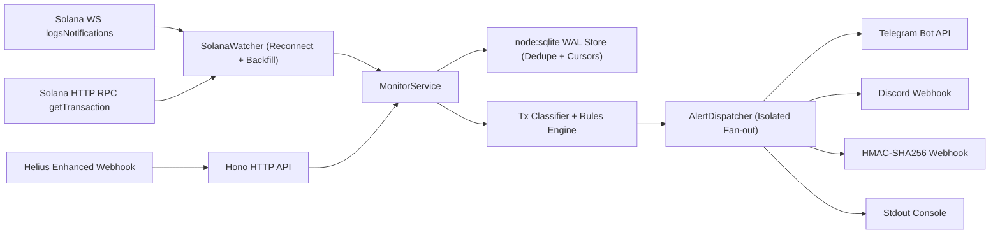

# solwatch

Self-hosted, read-only Solana wallet monitor and multi-channel alert router built with TypeScript, `@solana/kit`, Node 24 `node:sqlite`, `grammy`, and `hono`.

## Why This Exists

Most ad-hoc Solana wallet trackers break in the same three ways when deployed for real operational monitoring:

1. Public WebSocket subscriptions silently drop and miss every transaction that lands during the reconnect window.
2. Unfiltered `logsSubscribe` streams flood Telegram or Discord chats with 0-SOL fee calls, failed transactions, and airdrop spam mints.
3. Heavy stacks demand Redis + PostgreSQL just to watch a handful of treasury or smart-money wallets.

`solwatch` handles reconnect catch-up via `getSignaturesForAddress`, computes exact `BigInt` asset deltas to filter out fee-only calls and spam mints, deduplicates signatures in local SQLite WAL storage, and routes clean alerts to Telegram, Discord, HMAC-signed webhooks, or stdout. It never stores private keys or signs transactions.

## Quickstart (Zero-Config Demo)

Requires Node.js `>=24.0.0`. No API keys or external database needed to try the full pipeline:

```bash
git clone <your-repo-url>
cd solwatch
npm install
npm run demo
```

`npm run demo` runs an in-memory SQLite store and replays six realistic Solana transactions through the classifier, deduplication store, rule engine, and console formatter (including a duplicate signature and a denylisted Token-2022 spam mint).

To stream a live wallet from Devnet or Mainnet without running the HTTP server:

```bash
SOLANA_CLUSTER=devnet SOLANA_RPC_URL=https://api.devnet.solana.com SOLANA_WS_URL=wss://api.devnet.solana.com npm run demo -- --live <SOLANA_WALLET_ADDRESS>
```

## Production Setup & Docker

1. Copy the environment template and configure only the channels you want to enable:

```bash
cp .env.example .env
```

2. Start with Docker Compose:

```bash
docker compose up -d --build
```

3. Verify the container health and register a wallet:

```bash
curl http://localhost:3000/healthz
curl -X POST http://localhost:3000/api/wallets \
  -H "Content-Type: application/json" \
  -H "Authorization: Bearer $API_TOKEN" \
  -d '{"address":"9xQeWvG816bUx9EPjHmaT23yvVM2ZWbrrpZb9PusVFin","label":"Treasury"}'
```

## Architecture



## Telegram Bot Commands

Enable interactive commands by setting `TELEGRAM_BOT_TOKEN`, `TELEGRAM_INTERACTIVE_ENABLED=true`, and restricting access via `TELEGRAM_ALLOWED_CHAT_IDS`:

| Command                    | Description                                                           |
| :------------------------- | :-------------------------------------------------------------------- |
| `/watch <address> [label]` | Register a wallet and start live WS monitoring immediately            |
| `/unwatch <address>`       | Stop watching a wallet and remove it from active tracking             |
| `/list`                    | Show all tracked wallets and status                                   |
| `/recent`                  | Show the 5 latest alert delivery attempts                             |
| `/status`                  | Report cluster, watcher status, reconnect count, and pipeline metrics |

## HTTP API & Signed Webhooks

| Endpoint                              | Auth                    | Purpose                                                  |
| :------------------------------------ | :---------------------- | :------------------------------------------------------- |
| `GET /healthz`                        | Public                  | Container health, cluster, active channels, and counters |
| `GET /api/wallets`                    | Bearer `API_TOKEN`      | List tracked wallets and cursors                         |
| `POST /api/wallets`                   | Bearer `API_TOKEN`      | Add wallet `{ "address", "label?" }`                     |
| `DELETE /api/wallets/:address`        | Bearer `API_TOKEN`      | Remove wallet and stop its watcher                       |
| `GET /api/alerts?limit=25&wallet=...` | Bearer `API_TOKEN`      | Query delivery audit log                                 |
| `POST /webhooks/helius`               | `HELIUS_WEBHOOK_SECRET` | Ingest Helius Enhanced Webhook transaction arrays        |

When `WEBHOOK_SECRET` is set, outbound `WEBHOOK_URL` requests include `X-Solwatch-Delivery`, `X-Solwatch-Event`, and `X-Solwatch-Signature` (`sha256=<hex>`):

```ts
import { createHmac, timingSafeEqual } from "node:crypto";

export function verifySolwatchSignature(
  rawBody: string,
  headerSig: string,
  secret: string,
): boolean {
  const expected = `sha256=${createHmac("sha256", secret).update(rawBody).digest("hex")}`;
  const a = Buffer.from(headerSig);
  const b = Buffer.from(expected);
  return a.length === b.length && timingSafeEqual(a, b);
}
```

## Known Limitations & Trade-offs

- **Public RPC vs dedicated providers:** Public Solana endpoints aggressively rate-limit `getTransaction` and close idle WebSockets. For wallets with frequent trades, point `SOLANA_RPC_URL` / `SOLANA_WS_URL` at a dedicated provider or route transactions through `POST /webhooks/helius`.
- **Single-node SQLite WAL:** Using Node 24's built-in `node:sqlite` eliminates external database setup and native C++ compilation (`node-gyp`), at the cost of targeting single-instance deployments rather than horizontally scaled active-active workers.
- **Swap heuristics:** Swap classification identifies known DEX programs (Jupiter, Raydium, Orca, Meteora, Pump.fun) combined with net wallet balance deltas rather than decoding every protocol's IDL instructions. Exotic multi-program CPIs outside the registry classify as transfers or program interactions.
- **Read-only scope:** `solwatch` intentionally excludes private key custody, swap execution, and copy-trading.

## Development & Testing

```bash
npm run lint           # Biome formatting and lint rules
npm run typecheck      # Strict TypeScript check (tsc --noEmit)
npm run test:coverage  # Vitest unit + MSW/SQLite integration suite
npm run build          # Emit production JS into dist/
```
