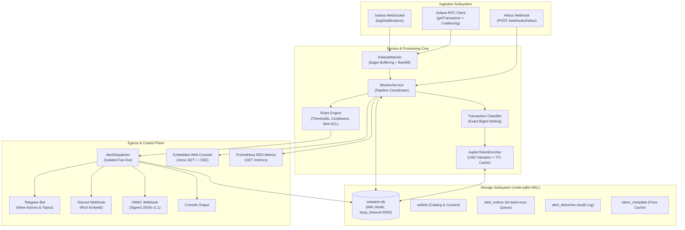

# Solwatch Architecture

`solwatch` is an event-driven, read-only transaction monitor and alert router designed specifically for the Solana blockchain. It provides high-reliability tracking for treasury, whale, and smart-money wallets with **zero external database dependencies** and **$0/mo infrastructure cost**.

---

## 1. High-Level System Architecture

---

## 2. Core Subsystems

### 2.1 Ingestion Subsystem (`src/solana/`)

1. **`SolanaWatcher` & Eager Stream Buffering:**
   - Subscribes to Solana's `@solana/kit` WebSocket wire protocol (`logsSubscribe({ mentions: [wallet] })`).
   - Solves the **lazy iterator race condition**: `@solana/subscribable` only registers consumers when stream iteration begins. `SolanaWatcher` starts pumping notifications into a local buffer (`stagingBuffer`) immediately before running RPC backfill catch-up.
   - Discovers Associated Token Accounts (ATAs) dynamically via `getTokenAccountsByOwner` (supporting both classic SPL Token and Token-2022 programs) to overcome the architectural limitation where `logsSubscribe` ignores deposits into existing ATAs.

2. **RPC Client & Coalescing (`rpcClient.ts`):**
   - Built-in global concurrency semaphore (`AsyncSemaphore`) preventing public RPC rate-limit exhaustion.
   - Ref-counted in-flight promise coalescing and LRU caching (`250` items) for `getTransaction` to eliminate redundant network roundtrips when multiple watched wallets interact in the same block.
   - Exponential backoff with full jitter on RPC errors `-32005` (rate limit) and `-32429` (too many requests).

3. **Helius Enhanced Webhook Adapter (`heliusAdapter.ts`):**
   - Ingests parsed transaction batches from Helius Webhooks via `POST /webhooks/helius`.
   - Fail-closed security: requires `HELIUS_WEBHOOK_SECRET` (>= 32 chars); returns `503` if unconfigured.
   - Quarantines malformed items per payload without failing the entire batch, returning `202 Accepted` and processing valid events asynchronously.

### 2.2 Transaction Classification & Valuation (`src/domain/`)

1. **Exact `BigInt` Math & Net Delta Calculation (`classifier.ts`):**
   - Zero floating-point rounding errors. All lamport and token calculations use native `BigInt`.
   - Computes net SOL delta accounting for transaction fees (`feePayer` vs passive recipient).
   - Automatically detects and isolates WSOL wrap/unwrap operations and SPL `closeAccount` rent reclaims (~0.002039 SOL) to prevent misreporting account cleanup as real deposits.
   - Subtacts Jito MEV tips sent to official tip accounts (`96gYZGLn...`, etc.) so miner bribery does not inflate transaction values.

2. **AMM & DEX Recognition:**
   - Detects swaps on Jupiter (v4/v6), Raydium (AMM, CPMM, CLMM), Orca Whirlpools, Meteora (DLMM, Pools), Pump.fun, and PumpSwap.
   - Disambiguates liquidity pool operations (mint/burn of LP tokens) from legitimate swaps.

3. **Zero-Cost USD Valuation (`src/solana/tokenEnricher.ts`):**
   - Interfaces with Jupiter Lite APIs (`https://lite-api.jup.ag/price/v3` and `tokens/v2`) requiring **no paid API keys** ($0/mo cost).
   - In-memory circuit breaker that falls back gracefully to SQLite-cached prices or stablecoin parity ($1.00 for USDC/USDT) during API downtime.

### 2.3 Rules Engine & Cooldown Store (`rules.ts`)

1. **Filtering Pipeline:**
   - `minSolLamports`: Evaluates native SOL and WSOL swap legs.
   - `minUsd`: Evaluates total estimated USD transaction value.
   - `mintAllowlist` / `mintDenylist`: Blocks known scam/airdrop tokens (e.g. Token-2022 dust mints).
   - `includeFailed`: Suppresses failed transactions by default.
   - Precedence: Wallet-specific rules override global rules; global rules act as fallback defaults.

2. **`CooldownTracker` Anti-Spam Store:**
   - Enforces per-wallet and per-event-type cooldown windows.
   - Bound memory footprint: automatically evicts oldest entries using an internal LRU queue when size reaches `MAX_ENTRIES` (10,000 keys).

### 2.4 Storage & Outbox Reliability (`src/store/sqliteStore.ts`)

1. **Node 24 `node:sqlite` WAL Mode:**
   - Leverages Node 24 native `DatabaseSync` without external C++ compilation (`node-gyp`).
   - Enforces `PRAGMA journal_mode = WAL`, `PRAGMA busy_timeout = 5000`, `PRAGMA synchronous = NORMAL`, and `PRAGMA temp_store = MEMORY`.
   - Atomic migrations tracked via `PRAGMA user_version` (v1 -> v2 -> v3).

2. **At-Least-Once Delivery via Outbox (`alert_outbox`):**
   - Critical alerts are queued in the outbox table inside the same transaction that claims the signature.
   - Dedicated background worker claims due items, executes isolated delivery, and implements exponential retry backoff before dead-lettering.
   - Monotonic keyset pagination (`listRecentAlerts` with `beforeId`) guarantees zero skipped or duplicate records during high-frequency inserts.

### 2.5 Multi-Channel Egress & Observability (`src/notifiers/`, `src/observability/`)

1. **Isolated Alert Dispatcher (`dispatcher.ts`):**
   - Delivery failures on one channel (e.g. Telegram rate-limit 429) do not block or delay delivery to other configured channels (Discord, Webhooks, Console).
   - Redacts sensitive secrets and tokens before logging or persisting errors to SQLite.

2. **SSRF Hardening (`src/security/ssrf.ts`):**
   - Enforces strict public IP validation on all outbound webhook requests.
   - Blocks IPv4/IPv6 private ranges (RFC 1918, CGNAT, Loopback, IMDS `169.254.169.254`, ULA `fc00::/7`, IPv4-mapped IPv6).
   - Multi-record DNS resolution verification (`assertResolvedHostPublic`) preventing DNS rebinding.
   - Configures HTTP client with `redirect: "error"` to block cross-protocol and open-redirect SSRF bypasses.

3. **Prometheus RED Observability (`metrics.ts`):**
   - Native Prometheus text exporter at `GET /metrics` (`text/plain; version=0.0.4`).
   - Implements the RED method: Rate (requests/sec), Errors (4xx/5xx), Duration (11-bucket histograms).
   - Low-cardinality route normalization (e.g. `/api/wallets/:address` instead of raw pubkeys).
